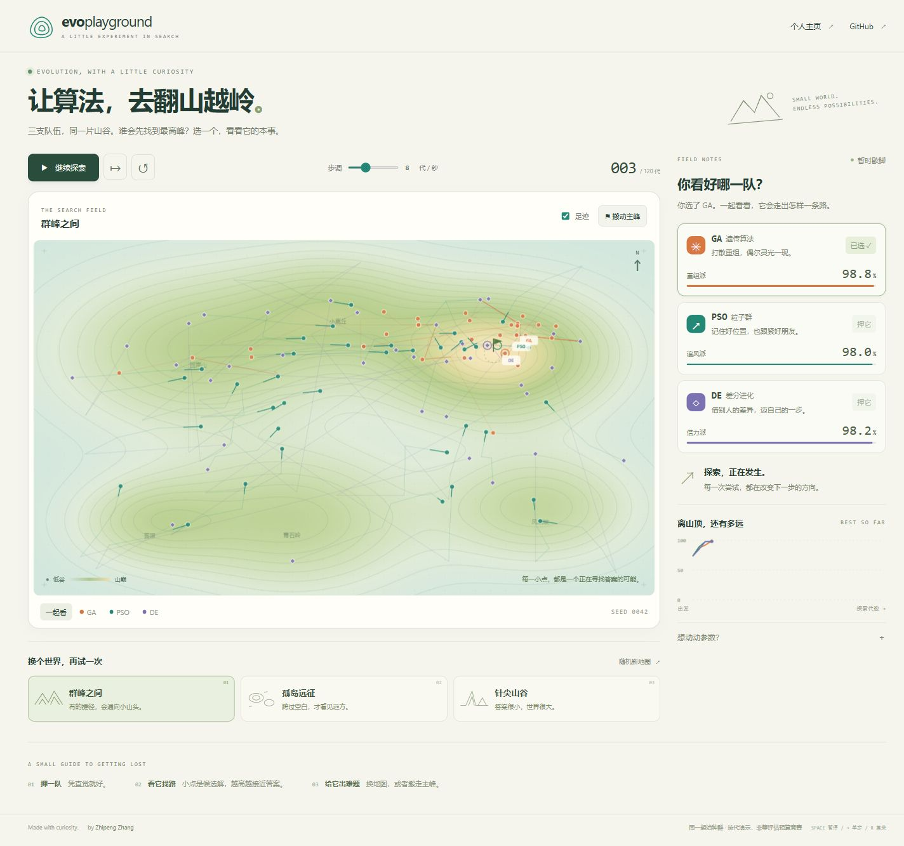

# Evo Playground

> **Interactive visualization of evolutionary algorithms exploring a multi-modal 2D fitness landscape.**

[](https://thinker-zzp.github.io/evo-playground)

---

## What is this?

A browser-based playground to visualize and compare three classic evolutionary / swarm-intelligence algorithms in real time:

| Algorithm | Abbr. | Key idea |
|-----------|-------|----------|
| Genetic Algorithm | **GA** | Selection → BLX-α crossover → Gaussian mutation → elitism |
| Particle Swarm Optimization | **PSO** | Particles chase personal best & global best, guided by inertia |
| Differential Evolution | **DE** | DE/rand/1/bin — scale-weighted difference vectors |

All three search a **2D multi-modal fitness landscape** built from 6 Gaussian peaks of different heights and widths. The **global maximum** sits in the upper-right region; five local optima act as traps.

## Demo



## Features

- 🎨 **Warm monochrome heatmap** with auto-generated contour bands
- 🔴 **Global best tracking** with real-time convergence chart
- 🐦 **PSO velocity arrows** and personal-best markers
- 🧬 **Particle trails** showing recent movement history
- ⚙️  **Live parameter sliders** — population size, mutation rate, inertia, etc.
- ⌨️  **Keyboard shortcuts**: `Space` run/pause · `→` step once · `R` reset
- 📱 Responsive layout (works on mobile)

## Getting Started

No build step needed — pure HTML + CSS + Vanilla JS.

```bash
git clone https://github.com/thinker-zzp/evo-playground.git
cd evo-playground
# Open index.html in your browser, or serve with any static server:
npx serve .
```

### Deploy to GitHub Pages

1. Push this repo to GitHub.
2. Go to **Settings → Pages → Source** and select `main` branch / root.
3. Your demo will be live at `https://<username>.github.io/evo-playground`.

## Project Structure

```
evo-playground/
├── index.html          # Main page
├── style.css           # Styles (homepage-matched palette)
└── js/
    ├── utils.js        # Shared helpers (clamp, gaussRand)
    ├── landscape.js    # Fitness landscape + cached heatmap rendering
    ├── ga.js           # Genetic Algorithm
    ├── pso.js          # Particle Swarm Optimization
    ├── de.js           # Differential Evolution
    └── app.js          # UI controller & animation loop
```

## The Fitness Landscape

Six Gaussian peaks in $[-5, 5]^2$ mapped to $[0, 1]^2$:

| Peak | Position (landscape) | Height | Width | Role |
|------|---------------------|--------|-------|------|
| 0 | (2.0, 1.0) | 1.00 | 1.20 | **Global maximum** |
| 1 | (−3.0, −2.0) | 0.85 | 1.30 | Strong local max |
| 2 | (1.0, −3.0) | 0.72 | 1.00 | Local max |
| 3 | (−1.5, 3.0) | 0.78 | 1.10 | Local max |
| 4 | (3.5, −1.5) | 0.65 | 0.90 | Local max |
| 5 | (−4.0, 1.5) | 0.55 | 0.80 | Weak local max |

$$f(x, y) = \sum_{k} h_k \exp\!\left(-\frac{(x-c_{x,k})^2 + (y-c_{y,k})^2}{2w_k^2}\right)$$

## Algorithm Details

### Genetic Algorithm
- **Selection**: Tournament (k = 3)
- **Crossover**: BLX-α (α = 0.5) — offspring can extend beyond parent range
- **Mutation**: Independent Gaussian per dimension ($\sigma = 0.08$)
- **Elitism**: Best individual always carried to next generation

### Particle Swarm Optimization
- **Velocity update**: $v \leftarrow \omega v + c_1 r_1 (\text{pbest} - x) + c_2 r_2 (\text{gbest} - x)$
- **Defaults**: $\omega = 0.729$, $c_1 = c_2 = 1.494$ (constriction factor scheme)
- **Boundaries**: Absorbing walls (damped reflection)

### Differential Evolution
- **Strategy**: DE/rand/1/bin
- **Mutant**: $v = x_a + F(x_b - x_c)$ for random $a, b, c \ne i$
- **Crossover**: Binomial with guaranteed *jRand* dimension
- **Selection**: Greedy — trial replaces target if at least as fit

## Related Work

This project was built alongside research on:
- Reinforcement learning-based algorithm selection
- Evolutionary computation
- Algorithm configuration & dynamic portfolio methods

See [thinker-zzp.github.io](https://thinker-zzp.github.io) for publications and research context.

## License

MIT © [Zhipeng Zhang](https://thinker-zzp.github.io)
